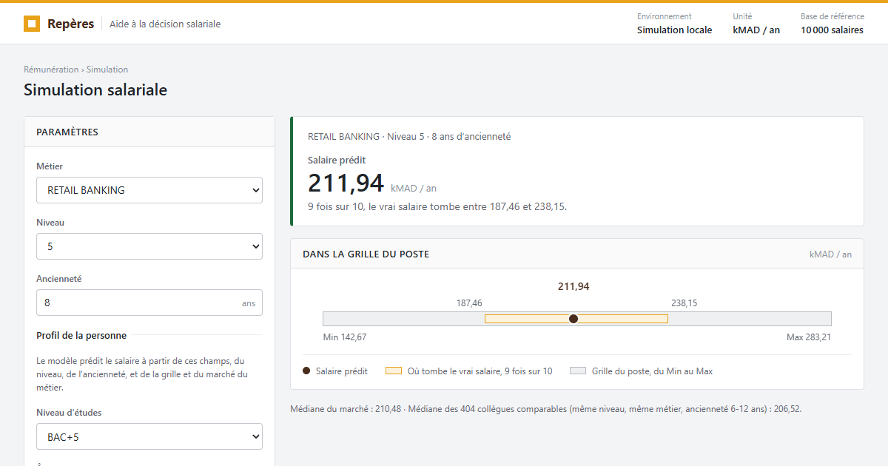

# Aide à la décision salariale

Pour un métier, un niveau et un profil, l'application donne **le salaire prédit par le modèle** et la fourchette où tombent 9 salariés sur 10 qui ont ce profil, placés dans la grille du poste.

Depuis le 17/11/2026, c'est son seul résultat : la fourchette et la cible tirées des règles ont été retirées, car elles faisaient un deuxième résultat à côté du salaire prédit, et la page montrait trop de chiffres. Le mode « vérifier un salaire » et le champ Matricule avaient été retirés le 09/11/2026.



## Démarrer

Depuis la racine du projet, dans PowerShell :

```powershell
.\.venv\Scripts\python.exe -m decision_support.app
```

Ouvrir **http://127.0.0.1:8765**. Arrêter avec `Ctrl+C`.
Si le port est occupé, ajouter `--port 8766`. Aucune dépendance supplémentaire n'est nécessaire.

L'application sert aussi les autres pages de l'interface, aux mêmes chemins que dans le projet : l'écran d'accueil (`/accueil.html`), l'exploration (`/visualisation/exploration_salaires.html`) et les tableaux de bord (`/output/dashboard/...`). Seules des pages, leurs scripts et leurs images sortent, jamais un fichier Excel. Dans l'aide à la décision, « Repères », en haut à gauche, ramène à l'écran d'accueil.

Le bouton « Refaire la détection » du tableau de bord passe par elle (`POST /api/detection`) : elle relance `src/detect_salary_anomalies.py`, puis relit les fichiers de `input/` pour l'aide à la décision. Il n'y a donc plus besoin de la redémarrer après avoir changé ces fichiers.

Pour ouvrir une de ces pages dès que l'application est prête, ajouter `--ouvrir` suivi de la page. C'est ce que fait `lancer_interface.bat`, à la racine du projet, avec l'écran d'accueil (`--ouvrir accueil.html`) : un double-clic sur ce fichier refait la détection, démarre l'application et ouvre l'écran d'accueil.

## Utilisation

1. Choisir le métier et le niveau (ceux du nouveau poste, pour une promotion).
2. Remplir le profil de la personne : ancienneté, niveau d'études, âge, compétence N-1, performance N-1 et Hot job. C'est ce que lit le modèle, avec les valeurs du fichier des salariés : un choix dans une liste, ou un nombre entre le plus petit et le plus grand du fichier. Tous les champs sont obligatoires : sans l'un d'eux, le modèle ne peut pas prédire.
3. Lire le salaire prédit.

### Partir d'un salarié (depuis le 23/11/2026)

Au lieu de remplir le profil à la main, taper un **matricule** en haut de la page, puis « Chercher » :

- le bloc **« Ce salarié aujourd'hui »** s'affiche : son salaire réel, sa position dans la grille (salaire ÷ milieu de la grille), sa priorité dans la détection, la recommandation avec son coût, et les raisons de la détection écrites en clair. Ce bloc ne bouge pas ensuite : c'est le vrai salarié ;
- le **profil** se remplit avec ses informations, sur une ligne ;
- le **salaire prédit** de son profil s'affiche, avec son salaire réel à côté et sur la figure (le trait noir).

Ensuite, **modifier une case** (l'ancienneté, la performance…) refait le salaire prédit. La case passe en jaune et la vraie valeur reste écrite dessous. Sous le grand chiffre, on lit le salaire prédit du vrai profil, l'effet des cases modifiées, et le salaire réel par rapport au salaire prédit. « Revenir au vrai profil » remet tout ; « Partir d'un profil vide » quitte le salarié.

Trois choses à savoir pour bien lire :

- le salaire prédit dit **ce que gagnent les salariés qui ont ce profil**. Ce n'est pas l'augmentation à donner à cette personne si sa situation change ;
- l'effet est donné **pour toutes les cases modifiées ensemble**, pas case par case : les effets ne s'additionnent pas ;
- **la priorité de la détection ne suit pas la simulation**. Elle se calcule en comparant le salarié à ses collègues sur tout le fichier : elle reste celle du vrai profil. Elle est lue dans `output/detection/anomalies.xlsx` ; ce gros fichier se charge en arrière-plan, donc pendant une vingtaine de secondes après le démarrage la page dit que la priorité se charge. Le « salaire attendu » de la détection n'est pas affiché : il vient d'une autre régression et ferait un deuxième chiffre à côté du salaire prédit.

## Lire le résultat

- **Le salaire prédit**, en grand, et dessous sa « fourchette habituelle pour ce profil » : 9 salariés sur 10 qui ont ce profil gagnent entre ces deux montants. Le modèle donne toujours le même salaire prédit pour un même profil : la fourchette dit de combien les vrais salaires s'en écartent d'habitude.
- **Dans la grille du poste** : une seule ligne. La barre grise est la grille, du Min au Max. Le point est le salaire prédit, et la barre dorée autour de lui est sa fourchette. On voit d'un coup d'œil si le salaire prédit est en bas, au milieu ou en haut de la grille, et si sa fourchette en sort.
- **Sous la figure**, une phrase donne les deux autres repères : la médiane du marché, et la médiane des collègues comparables, avec leur nombre et le groupe retenu.

Aucun profil saisi n'est enregistré sur le serveur. Les fichiers d'entrée ne sont pas modifiés.

Les couleurs de marque sont regroupées en haut de `static/style.css` (`--brand`, `--brand-soft`, `--brand-dark`) pour être ajustées à la charte officielle.

## Références utilisées

- `input/bands.xlsx` : ligne exacte **métier + niveau**. Les grilles de métiers différents ne sont jamais mélangées.
- `input/market.xlsx` : médiane du même métier et niveau. Le fichier peut être absent.
- `input/employes.xlsx` : les collègues, choisis comme dans `src/anomaly_cohortes.py` : même niveau + même métier + même tranche d'ancienneté, sinon même niveau + même métier, sinon même niveau seul (tous métiers). Le premier groupe qui compte au moins `cohort_min_size` collègues est retenu.
- `config/rules.yaml` : l'effectif minimal d'un groupe de collègues (`cohort_min_size`) et les groupes à essayer (`cohort_widening_steps`). Les seuils des règles ne servent plus ici.
- Le modèle du salaire prédit, appris au démarrage. Depuis le 24/11/2026, il est écrit une seule fois, dans `src/anomaly_signal_regression.py` (`entrainer_m5`), et la détection lit le même. Depuis le 17/11/2026, sa façon de faire est celle du modèle M5 du notebook `notebooks/Prediction_Compa_Ratio.ipynb` (du 16/11 au 17/11, c'était M6, qui apprenait le Compa-Ratio) :
  - il apprend le **salaire**, en logarithme : un écart se lit alors en pourcentage, et les très hauts salaires pèsent moins. Salaire prédit = exponentielle du log prédit ;
  - avec un **gradient boosting** : des centaines de petits arbres qui se corrigent l'un l'autre, pour suivre des effets qui ne sont pas en ligne droite ;
  - il lit les colonnes du notebook (liste `COLONNES_M5`, dans `src/anomaly_signal_regression.py`) : le niveau, le niveau d'études (en rang), l'âge à l'embauche (âge − ancienneté), l'ancienneté, la compétence N-1, la performance N-1 (en rang), le Hot job et le ratio grille / marché. Il reçoit en plus le Mid de la grille, en logarithme : c'est par lui qu'il connaît la grille du poste. Il ne lit plus le métier, le 9Box ni la catégorie d'école, et toujours ni le sexe, ni le pôle ;
  - la fourchette « 9 salariés sur 10 » : chaque salarié est prédit par un modèle qui ne l'a pas vu, et on garde les erreurs entre les 5 % les plus basses et les 5 % les plus hautes.

  Depuis le 24/11/2026, la détection calcule son salaire attendu avec ce même modèle. Il reste un petit écart entre les deux chiffres, et c'est voulu : pour la détection, chaque salarié est prédit par un modèle qui ne l'a pas vu (sinon un salaire anormal tirerait le modèle vers lui et se cacherait) ; cette page interroge le modèle appris sur tous les salariés. Et un salarié peut être sous la fourchette de cette page tout en restant « Info » : l'écart au salaire attendu ne compte que pour 30 % du score de la détection (`ml_weight`), les règles pour 70 %.

Les montants sont en **kMAD par an**, comme dans les fichiers d'entrée.

Les sources sont chargées au démarrage. **Redémarrer après une modification.**

Le sexe n'est jamais utilisé. Comme dans `src/anomaly_pretraitement.py`, un matricule en double, ou un métier + niveau en double dans la grille ou le marché, garde sa première ligne. Sans grille exploitable pour le métier et le niveau choisis (ou sans marché), il n'y a pas de salaire prédit : la page le dit.

## Portée de cette version

Le modèle apprend une fois, au démarrage, en quelques secondes. La page ne relance ni les règles, ni l'Isolation Forest, et ne calcule pas de score général.

Le salaire prédit est ce que le modèle attend pour un tel profil, d'après les salaires d'aujourd'hui : c'est un **repère de discussion à valider**, pas un salaire optimal démontré. Si les salaires d'aujourd'hui portent des écarts injustifiés, le modèle les a appris avec le reste. Les données du projet doivent être confirmées comme références métier avant un usage opérationnel.

L'application écoute uniquement sur l'ordinateur local. Elle n'est pas un service multi-utilisateur déployé.
