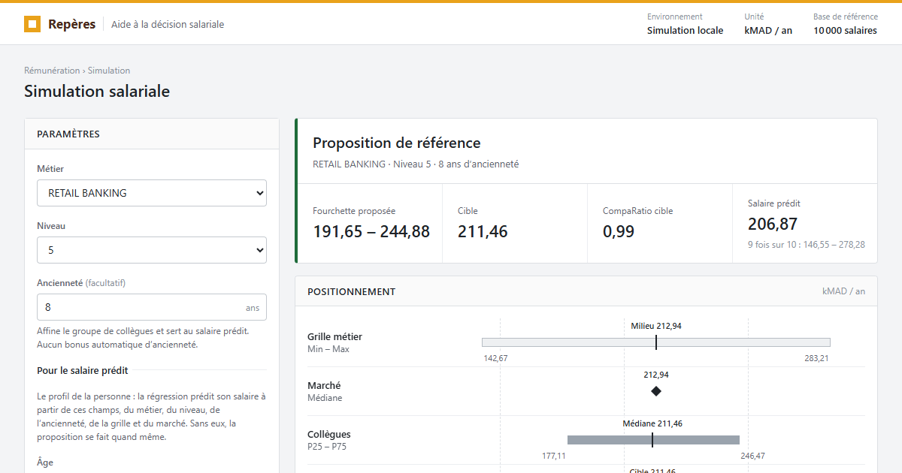

# Aide à la décision salariale

Pour un métier et un niveau, l'application **propose une fourchette et une cible de salaire**, et donne le salaire prédit par la régression pour le profil saisi. Le mode « vérifier un salaire » et le champ Matricule ont été retirés le 09/11/2026.



## Démarrer

Depuis la racine du projet, dans PowerShell :

```powershell
.\.venv\Scripts\python.exe -m decision_support.app
```

Ouvrir **http://127.0.0.1:8765**. Arrêter avec `Ctrl+C`.
Si le port est occupé, ajouter `--port 8766`. Aucune dépendance supplémentaire n'est nécessaire.

## Utilisation

1. Choisir le métier et le niveau.
2. Renseigner l'ancienneté si une comparaison plus fine est souhaitée.
3. Pour le salaire prédit, remplir les champs « Pour le salaire prédit » : âge, compétence N-1, performance N-1, positionnement 9-Box, Hot job, niveau d'études et catégorie d'école (et l'ancienneté, plus haut). Ce sont les colonnes que lit la régression, avec les valeurs du fichier des salariés : un choix dans une liste, ou un nombre entre le plus petit et le plus grand du fichier. La grille et le marché sont ceux du métier et du niveau choisis (ceux du nouveau niveau, pour une promotion). Ces champs sont facultatifs : sans eux, la proposition se fait quand même, et le bandeau dit lesquels manquent.
4. Consulter les comparaisons, la fourchette et la cible indicative.

## Lire le résultat

Chaque chiffre n'apparaît qu'à un seul endroit :

- **Bandeau de synthèse** : verdict (proposition de référence, points à examiner si les repères se contredisent, références incomplètes), fourchette proposée, cible et CompaRatio de la cible. Quand tous les champs du salaire prédit sont remplis, le salaire prédit par la régression et sa fourchette, où le vrai salaire tombe 9 fois sur 10 : un repère en plus, qui ne change ni le verdict ni la fourchette proposée.
- **Positionnement** : une règle place sur la même échelle la grille (min–max et milieu), la médiane du marché, les collègues (P25–P75 et médiane) et la fourchette proposée. Les montants sont écrits sur les barres. Une phrase indique le nombre de collègues comparés et le périmètre retenu.

Aucun profil saisi n'est enregistré sur le serveur. Les fichiers d'entrée ne sont pas modifiés.

Les couleurs de marque sont regroupées en haut de `static/style.css` (`--brand`, `--brand-soft`, `--brand-dark`) pour être ajustées à la charte officielle.

## Références utilisées

- `input/bands.xlsx` : ligne exacte **métier + niveau**. Les grilles de métiers différents ne sont jamais mélangées.
- `input/market.xlsx` : médiane du même métier et niveau. Le fichier peut être absent.
- `input/employes.xlsx` : les collègues, choisis comme dans `src/anomaly_cohortes.py` : même niveau + même métier + même tranche d'ancienneté, sinon même niveau + même métier, sinon même niveau seul (tous métiers). Le premier groupe qui compte au moins `cohort_min_size` collègues est retenu. Sans ancienneté saisie, le premier niveau est sauté.
- `config/rules.yaml` : seuils des cinq règles (grille, CompaRatio, marché, écart entre pairs, salaire minimum du niveau), effectif minimal et groupes de collègues.
- `src/anomaly_signal_regression.py` : le modèle de régression, entraîné au démarrage de la même façon qu'en ligne de commande, donc avec les mêmes résultats. Il lit le métier, le niveau, le Mid de la grille, le ratio grille / marché, l'ancienneté, l'âge, la compétence N-1, la performance N-1, le 9Box, le Hot job, le niveau de diplôme et la catégorie d'école. Il ne lit ni le salaire (c'est ce qu'il prédit), ni le Min et le Max, ni le sexe, ni le pôle : les raisons sont écrites en tête du fichier.

Les montants sont en **kMAD par an**, comme dans les fichiers d'entrée.

Les sources sont chargées au démarrage. **Redémarrer après une modification.**

L'âge, la compétence, la performance, le 9Box, le Hot job et le diplôme ne servent qu'au salaire prédit par la régression : ils ne déterminent ni le verdict ni la fourchette proposée. Le sexe n'est jamais utilisé. Aucun coefficient supplémentaire n'est inventé. L'ancienneté affine la comparaison, sans majoration automatique.

## Méthode de proposition

La fourchette est l'intersection de la bande interne, de l'intervalle autorisé par le CompaRatio, des tolérances du marché et, si l'effectif suffit, des quartiles P25–P75 des pairs. Elle reste aussi en deçà du seuil d'alerte entre pairs, et ne descend jamais sous le salaire minimum du niveau. La cible est leur médiane, ramenée dans cette fourchette. Sans pairs suffisants, le milieu de grille sert de cible et la référence est signalée comme incomplète.

Les bornes sont arrondies vers l'intérieur à deux décimales. La cible est revérifiée par les cinq règles : si elle déclenchait elle-même une alerte, aucune proposition n'est faite. Les seules différences d'arrondi informatique aux seuils sont neutralisées.

Une grille absente ou invalide empêche la proposition. Des repères incompatibles ne donnent aucune fourchette (verdict « Points à examiner ») plutôt qu'un montant inventé. Comme dans `src/anomaly_pretraitement.py`, un matricule en double, ou un métier + niveau en double dans la grille ou le marché, garde sa première ligne.

Cette vérification applique les cinq règles de `src/anomaly_regles.py`, avec les seuils de `config/rules.yaml` : comme dans le programme principal, un salaire à peine sous le Min reste dans la marge tolérée, et seul un salaire trop bas lève une alerte (décision du comité du 15/10/2026). L'écart entre pairs est calculé comme PeerZ dans `src/anomaly_cohortes.py`, mais sur les collègues seuls.

La moitié centrale des pairs sert à construire une proposition. Être en dehors de cette moitié ne déclenche pas à lui seul une alerte : la vérification de la cible utilise le seuil d'écart entre pairs.

## Portée de cette version

Cette version utilise des comparaisons explicites. Elle ne relance ni l'Isolation Forest ni l'apprentissage de la régression à chaque saisie (le modèle apprend une fois, au démarrage), et ne calcule pas de score général : seules les règles sont appliquées.

La proposition est un **repère de discussion à valider**, pas un salaire optimal démontré. Dans le jeu actuel, le marché et le milieu de grille sont identiques : ce ne sont pas deux repères indépendants. Les données du projet doivent être confirmées comme références métier avant un usage opérationnel.

L'application écoute uniquement sur l'ordinateur local. Elle n'est pas un service multi-utilisateur déployé.
